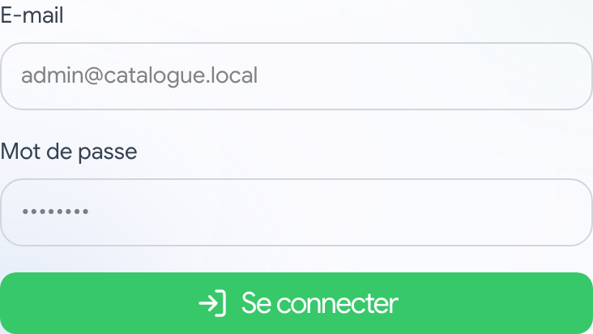
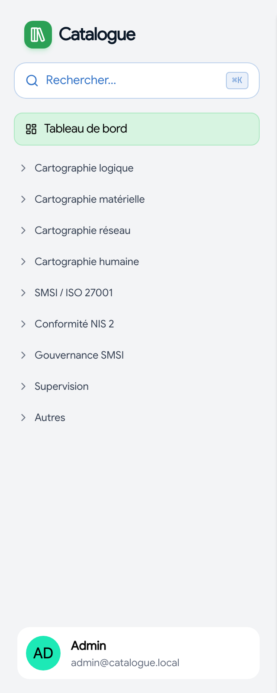
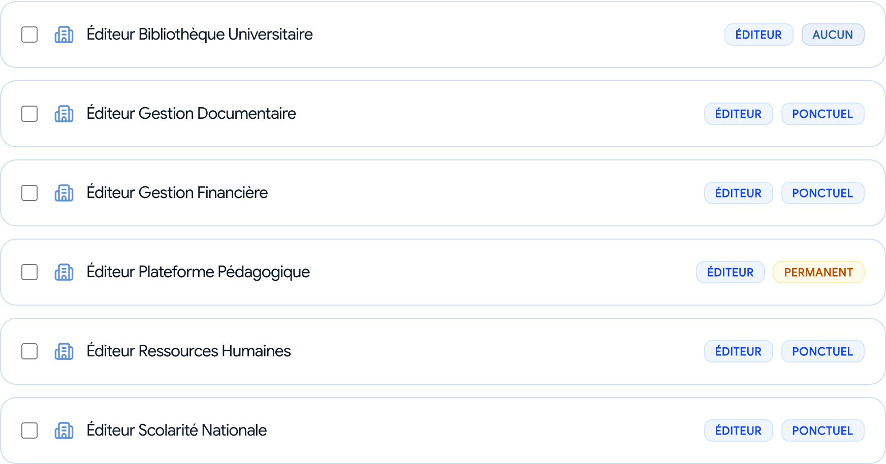
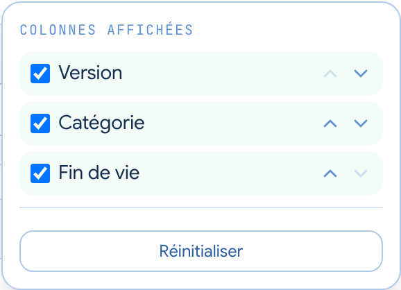
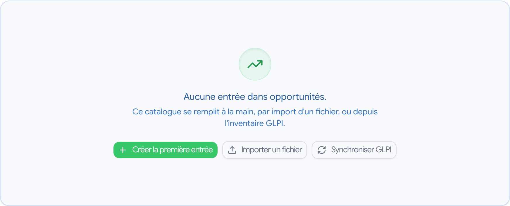
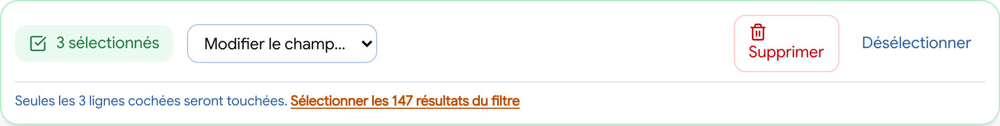
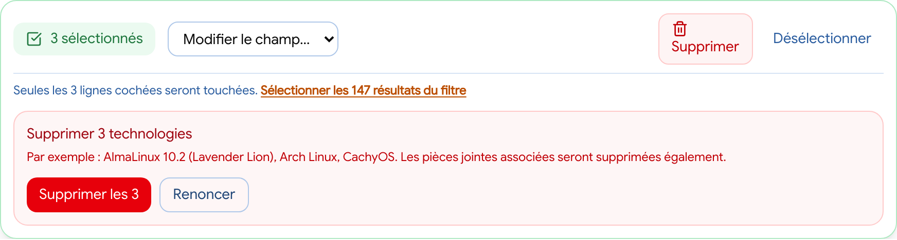
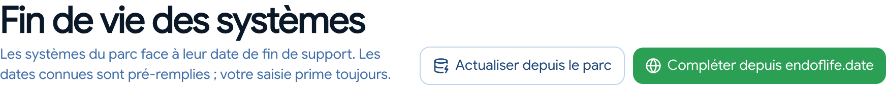
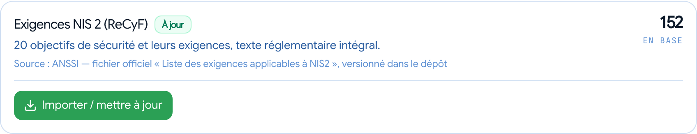

# Guide utilisateur — Catalogue

Catalogue recense le patrimoine numérique de l'établissement et le relie aux démarches réglementaires. Ce guide explique ce que vous pouvez y faire, dans l'ordre où vous en aurez besoin.

> Les captures de ce guide sont **régénérables** : `bun doc/captures.ts`. Elles montrent les commandes de l'interface ; les quelques données visibles sont **fictives**, jamais celles de l'inventaire.

---

## 1. Se connecter

En production, la connexion se fait avec vos **identifiants habituels de l'université**, via le SSO. Vous êtes redirigé vers la page d'authentification commune, puis ramené dans l'application.

Si l'authentification unique est indisponible, une **connexion de secours** existe sur `/login-secours`, accessible par un lien discret en bas de la page de connexion. Elle est réservée aux situations de panne : son usage est enregistré au journal d'audit.

> Après plusieurs mots de passe erronés, la connexion est **temporairement bloquée** — quelques minutes d'abord, davantage si les tentatives se répètent. Le message indique le délai à attendre. Une connexion réussie remet le compteur à zéro.

### « Je suis connecté mais je ne vois rien »

C'est le cas le plus fréquent, et **ce n'est pas une panne**. Vos droits ne viennent pas de l'annuaire : ils s'attribuent **catalogue par catalogue** dans l'application. À votre première connexion, vous êtes authentifié sans aucun accès.

Demandez à un administrateur de vous donner un rôle sur les domaines qui vous concernent — il lui suffit de quelques secondes.

### Se déconnecter

Cliquez sur votre nom en bas du menu : le menu déroulant propose *Mon profil* et *Se déconnecter*. Sur un poste partagé, pensez-y — votre session reste ouverte plusieurs jours.

---

## 2. Qui peut faire quoi

Vos droits ne sont **pas globaux** : vous avez un rôle sur chaque domaine séparément. Vous pouvez très bien être gestionnaire des applications et simple lecteur du parc.

| Votre rôle | Ce que vous pouvez faire |
|---|---|
| **Lecteur** | consulter, filtrer, exporter |
| **Contributeur** | consulter, et **proposer** des modifications : elles partent en validation |
| **Gestionnaire** | consulter et modifier directement |
| **Administrateur** | tout, plus les réglages, les connecteurs et les référentiels |

En tant que **contributeur**, rien n'est perdu quand vous enregistrez : votre modification devient une **demande** qu'un gestionnaire approuve ou refuse. Elle est ensuite appliquée telle que vous l'aviez saisie — vous n'avez pas à la ressaisir.

C'est le bon rôle quand vous connaissez le terrain sans être responsable du catalogue : un correspondant informatique de composante, par exemple, peut corriger le rattachement de ses machines sans qu'on lui confie l'ensemble du parc.

### Pourquoi les droits sont-ils si découpés ?

Parce qu'un catalogue de risques et un inventaire de postes n'ont ni les mêmes lecteurs ni les mêmes responsables. Un découpage global obligerait à choisir entre tout ouvrir et tout fermer.

### Savoir ce à quoi vous avez droit

Votre page **Mon profil** liste vos accès, domaine par domaine, avec le rôle que vous y avez et ce qu'il autorise. C'est là qu'il faut regarder quand une page vous est refusée : il vous manque un rôle sur ce domaine, votre connexion n'est pas en cause.

On y accède par le menu, ou en cliquant sur votre nom en bas de la barre latérale.

---

## 3. Se repérer

Le menu regroupe les pages par domaine : cartographies, conformité, gouvernance, supervision. Il peut être **réorganisé**, et vos pages fréquentes **épinglées** en haut — ces réglages vous suivent d'un poste à l'autre.

`Cmd+K` (ou `Ctrl+K`) ouvre la **recherche globale** depuis n'importe quelle page. Le **plan du site** liste l'intégralité des pages si vous préférez parcourir.

---

## 4. Les catalogues

Un catalogue est une liste : applications, serveurs, postes de travail, tiers, processus, risques…

### Chercher et filtrer

La barre du haut cherche dans tout le contenu. Les filtres se combinent — par exemple : serveurs **et** environnement de production **et** une composante donnée.

**Vos filtres sont dans l'adresse.** Concrètement :
- le bouton **Partager la vue** copie un lien qui rouvre exactement la même liste chez un collègue ;
- quand vous revenez d'une fiche, vous retrouvez votre page, vos filtres et votre tri — pas le début de la liste.

### Cartes ou tableau

Deux façons de voir la même liste :

- **Cartes** — pour parcourir et cliquer ; chaque entrée montre son nom et ses caractéristiques en pastilles. Un champ non renseigné **n'affiche pas de pastille** : une pastille « — » n'apprend rien et noierait celles qui portent une information ;
- **Tableau** — pour **comparer** : colonnes alignées, tri en cliquant sur un en-tête.

*Les données de cette capture sont fictives.*

Choisissez les cartes quand vous cherchez **une** entrée, le tableau quand vous voulez en **confronter plusieurs** — par exemple trier des machines par date de fin de support pour voir d'un coup celles qui posent problème.

### Choisir ses colonnes

En mode tableau, le bouton **Colonnes** ouvre le réglage : cochez celles qui vous intéressent, ordonnez-les avec les flèches. Quatre colonnes sont affichées par défaut — au-delà, le tableau devient difficile à lire.

Votre choix est **mémorisé par catalogue** : travailler en tableau sur les serveurs ne l'impose pas à vos collègues.

### Au clavier

Sur une liste : `j` et `k` pour parcourir, `Entrée` pour ouvrir, `Espace` pour cocher, `Échap` pour tout décocher.

### Quand une liste est vide

Un catalogue vide ne se contente pas de le constater : il propose les trois façons de le remplir — saisie, import de fichier, ou synchronisation depuis l'inventaire.

---

## 5. Modifier plusieurs lignes d'un coup

Cochez plusieurs lignes : une barre d'actions apparaît en bas. Vous pouvez **affecter en masse** une valeur (composante, service, statut, criticité…) ou **supprimer**. C'est ce qui rend tenable la qualification d'un parc étendu.

### Trois garde-fous

**1. La confirmation montre ce qui va être touché** — le nombre, le champ, la valeur cible et trois exemples de lignes. Pas un « Êtes-vous sûr ? » qui n'informe de rien.

**2. Tout est annulable.** Après l'action, un bandeau propose *Annuler* pendant quelques secondes. L'annulation fonctionne aussi pour les suppressions, et survit à un rechargement de page.

**3. La sélection ne dépasse jamais la page affichée**, sauf demande explicite de votre part.

### Agir sur tous les résultats d'un filtre

Quand votre filtre ramène plus de lignes que la page, un lien propose de **sélectionner l'ensemble des résultats** — y compris ceux que vous ne voyez pas. La barre passe alors en orange avec un avertissement, et la confirmation le rappelle explicitement.

Cette portée élargie **revient automatiquement à la sélection normale** dès que vous cochez ou décochez quoi que ce soit : c'est ce qui évite d'agir par mégarde sur tout un catalogue.

---

## 6. Les cartographies

Quatre vues transverses du patrimoine :

- **Applicative** — applications, flux entre elles, dépendances ;
- **Infrastructure** — serveurs, postes, réseau, VPN, matériel ;
- **Données** — actifs informationnels, traitements, sensibilité ;
- **Humaine** — personnes, organigramme, compétences, RACI.

### Les périmètres

La page **Périmètres** est la plus utile au quotidien : elle donne, pour une composante, un département, un service ou un lieu, **tout ce qui s'y rattache** — machines, applications, personnes, référents — et sa **posture de sécurité**.

C'est là que remontent les **machines en fin de support** du périmètre, avec le détail des systèmes concernés. Sur la liste des périmètres, un **compteur rouge** signale d'emblée ceux qui portent des machines hors support — rien ne s'affiche quand tout va bien.

> Les unités d'organisation — **Entités, Composantes, Départements, Services, Pôles** — figurent dans **deux** menus : la cartographie humaine (« qui ») et la cartographie matérielle (« quelles machines »). C'est la même page : une fiche d'unité répond aux deux questions, et la chercher au seul endroit où l'on avait pensé à la ranger faisait tourner en rond.

Sur la fiche d'un service ou d'un département, les chiffres de couverture EDR se détaillent **par pôle** quand l'information existe — sans quoi un service de deux cents machines ne dit pas où se trouve l'écart.

---

## 7. La conformité

### SMSI / ISO 27001

Les **93 mesures de l'Annexe A** constituent votre Déclaration d'Applicabilité. Pour chacune : applicable ou non, justification, état de mise en œuvre, preuves.

### NIS 2 / ReCyF

Les **152 exigences officielles de l'ANSSI**, avec leur **texte réglementaire intégral** — c'est ce texte qui sera lu en audit, pas un résumé.

Chaque exigence porte son état de conformité, son responsable, ses actions et ses preuves. Le **plan d'actions** offre la vue d'ensemble.

Selon que l'établissement est déclaré **entité importante** ou **entité essentielle**, les exigences applicables diffèrent : l'application n'affiche que celles qui vous concernent. L'applicabilité se lit **exigence par exigence** — 13 objectifs sur 20 mélangent les deux portées.

### Notification d'incident

Un incident **P1 — Critique** ou **P2 — Majeur** remonté par Sniff crée automatiquement un **brouillon de notification** avec ses trois échéances réglementaires : **24 heures** (alerte précoce), **72 heures** (notification), **1 mois** (rapport final). Les gravités s'affichent partout selon la grille P1…P4 de la cellule. Les échéances proches sont rappelées sur le tableau de bord.

Les délais courent depuis la **prise de connaissance** de l'incident. Quand cette date est approchée plutôt que certaine — reprise du constat technique, ou de la date de saisie dans Sniff — le suivi porte la mention **« date estimée »** : les échéances calculées sont alors à lire comme un majorant, la connaissance réelle a pu être antérieure.

### EBIOS RM

Les cinq ateliers de la méthode : cadrage et socle, sources de risque, scénarios stratégiques, scénarios opérationnels, traitement du risque.

### RGPD — sécurité des traitements

Le **Catalogue RGPD** (menu Conformité) liste les applications qui traitent des données personnelles, avec leur état : **non évaluée** (gris — du travail à faire, pas un manquement), **conforme** (vert), **écart constaté** (rouge, panneau d'attention). Ce n'est **pas le registre des activités de traitement** de l'article 30, qui relève du délégué à la protection des données : la page couvre la sécurité des traitements, rien d'autre.

L'évaluation se fait **sur la fiche de chaque application**, dans le formulaire de modification (section « Sécurité & données », dès que la case « données personnelles » est cochée) : huit exigences à qualifier — conforme, non conforme ou non applicable, avec justification — et le bloc **analyse d'impact** (statut, motif, conclusion, dates). Si la conclusion est « risque résiduel élevé », l'application rappelle l'obligation de **consulter la CNIL avant le traitement** (art. 36) ; la date de réexamen (art. 35.11) remonte dans les échéances.

### Clauses ISO 27001

Les **clauses 4 à 10** du système de management se suivent une par une (menu Gouvernance SMSI → Clauses ISO 27001) : conformité, plan, échéance, preuve, responsable. C'est l'exercice complémentaire de la Déclaration d'Applicabilité — un audit de certification demande les deux. Chaque fiche d'exigence NIS 2 affiche par ailleurs la **correspondance officielle de l'ANSSI** vers ces clauses et les mesures de la SoA, avec son niveau : « faible » désigne ce que l'ISO ne couvre pas — le travail restant même pour un établissement certifié.

---

## 8. Fin de vie des systèmes

La page **Fin de vie** dresse l'état du parc au regard du support éditeur. Quatre situations :

| Statut | Signification |
|---|---|
| **Dépassé** | plus aucun correctif de sécurité — à traiter |
| **Support étendu** | le support standard est fini, mais un contrat le prolonge (ESU Windows, ESM Ubuntu) |
| **Supporté — sans date annoncée** | l'éditeur confirme qu'il ne publie pas de date de fin (cas d'Apple) |
| **Date inconnue** | l'information manque : à compléter |

Le bouton **Compléter depuis endoflife.date** récupère les dates publiques. Il ne touche **jamais** une date que vous avez saisie à la main : votre décision prime toujours.

Une date manquante se corrige directement depuis cette page, sans passer par la fiche du système.

Sur les listes de machines, une pastille rouge **« Incident »** signale celles qui font l'objet d'un incident en cours dans Sniff. Attention à ce qu'elle ne dit pas : son **absence ne prouve rien** — la machine peut être inconnue de l'inventaire, ou Sniff injoignable. La fiche de la machine, elle, distingue explicitement « aucun incident » de « pas de réponse ». **La fiche fait foi, la liste est une commodité.**

La **criticité** apparaît désormais dans le bandeau de chaque fiche, juste sous le nom, avec une icône sur les niveaux forts.

La fin de support **vous suit hors de cette page** : les cartes des serveurs et postes de travail portent une pastille rouge « Fin de support » (ou ambre « Support étendu »), et la fiche d'une machine concernée affiche un bandeau avec la date et le lien vers cette page. Pas de pastille = machine supportée ou non évaluée.

> Un système dont la version n'est pas renseignée dans l'inventaire reste en « date inconnue » : l'application **ne devine pas**. Une date fausse qui rassure serait pire qu'un trou qui invite à compléter l'inventaire.

---

## 8 bis. L'audit de surface

Un moteur extérieur relève ce que l'on voit de nos sites **depuis Internet** et rend des
**constats** : certificat, TLS, en-têtes, fichier ou outil exposé, version obsolète, DNS,
intégrité des scripts servis. Le Catalogue ne relève rien lui-même ; il reçoit, suit, et
vous fait décider.

Sur un constat, quatre décisions : **accepter** (avec une échéance — l'acceptation n'est pas
perpétuelle), **corriger**, **vérifier** après correction, **rouvrir**. Chacune garde son
motif et son auteur, et un constat peut être **relié à un incident Sniff** déclaré de l'autre
côté.

Trois choses à savoir pour lire ces pages sans se tromper :

- **« corrigé » veut dire déclaré corrigé**, pas vérifié. Le statut passe à « re-testé »
  seulement quand le moteur a repassé sur le site après la correction sans revoir le constat.
- **un constat qui disparaît ne prouve rien** : le moteur a peut-être simplement sauté
  l'actif. C'est pourquoi la confirmation demande un passage daté.
- **une acceptation échue rouvre le constat** dès qu'il est revu. Sans cela, un risque
  assumé six mois plus tôt passerait pour traité.

Le **Tableau de bord** répond à « qui a quoi à traiter » : par composante, par propriétaire,
par classement. Les constats sans interlocuteur — service hors inventaire, sans propriétaire
désigné — ont leur propre ligne plutôt que d'être écartés : ce sont les premiers à traiter.

---

## 9. Les référentiels

Réservé aux administrateurs. Chaque référentiel affiche **sa source**, la volumétrie attendue, celle réellement en base, et un **indicateur d'écart** qui signale s'il faut réimporter.

L'import met à jour ce qui appartient à la source — intitulés, applicabilité, rattachements — et **jamais votre travail** : conformité déclarée, plans d'action, responsables et preuves sont conservés.

---

## 10. Quelques façons de travailler

### Qualifier un parc qui arrive de l'inventaire

Les machines synchronisées depuis GLPI arrivent avec leur composante, mais pas toujours avec leur service ni leur criticité. La méthode la plus rapide :

1. filtrez sur ce qui n'est pas encore qualifié ;
2. triez en mode tableau par composante, pour regrouper ce qui va ensemble ;
3. cochez un bloc cohérent, affectez la valeur en une fois ;
4. vérifiez le bandeau de confirmation — et si vous vous êtes trompé, **annulez**.

### Préparer une revue avec une composante

Ouvrez le **périmètre** de la composante : vous y trouvez ses machines, ses applications, ses référents et sa posture. Le lien de la page se partage tel quel ; votre interlocuteur verra exactement la même chose.

### Suivre une échéance réglementaire

Le tableau de bord affiche en premier ce qui a une date : notifications NIS 2, contrats et revues de tiers, accès VPN, fins de vie et de support, revues d'homologation, réexamens d'analyse d'impact RGPD. Une échéance à 24 ou 72 heures ne se rattrape pas — c'est pourquoi elle est en tête de page et non dans un onglet.

### Retrouver ce qui a changé

Le **journal d'audit** enregistre qui a modifié quoi, avec le détail des valeurs avant et après. Utile après une action groupée, ou quand une donnée ne correspond plus à ce que vous aviez saisi.

---

## 11. Questions fréquentes

**J'ai supprimé quelque chose par erreur.**
Si c'était une action groupée, le bandeau *Annuler* reste actif quelques secondes, et l'annulation fonctionne même après un rechargement de page. Passé ce délai, contactez un administrateur : les points d'annulation sont conservés 24 heures côté serveur.

**Une page a disparu du menu.**
Trois causes possibles, dans l'ordre : un **cadre de référence décoché** dans Réglages la masque pour tout le monde (les données sont intactes — demandez à un administrateur) ; il vous manque un **rôle** sur ce domaine (voir Mon profil → Mes accès) ; ou l'entrée a simplement changé de section — le **Plan du site** liste tout.

**Une machine n'apparaît pas.**
Elle vient peut-être d'être ajoutée dans GLPI : la synchronisation tourne toutes les 15 minutes. Si elle n'apparaît toujours pas, elle est peut-être dans la file « à classer » de la page GLPI.

**Une machine a une date de fin de support « inconnue ».**
Soit son système n'est pas couvert par la source publique, soit sa **version n'est pas renseignée** dans l'inventaire. L'application ne devine pas : une date fausse serait pire qu'une absence. Vous pouvez la saisir à la main.

**Le nombre de machines hors support a bougé sans que je ne fasse rien.**
Les dates de support évoluent : une release qui était couverte hier ne l'est plus aujourd'hui. C'est le rôle du référentiel de le refléter.

**J'ai perdu mes filtres en changeant de page.**
Normalement non : ils sont dans l'adresse. Si vous êtes arrivé par un lien du menu plutôt que par le bouton *Précédent*, vous repartez d'une vue neuve — c'est le comportement attendu.

---

## 12. Mon profil

Votre page personnelle rassemble quatre choses :

**Mes accès** — la liste de vos rôles par domaine. La réponse à « pourquoi cette page m'est-elle refusée ? ».

**Notifications** — les alertes envoyées par le navigateur, même application fermée. L'abonnement vaut **pour ce navigateur** : activez-le sur chaque appareil où vous voulez être prévenu. Vous choisissez les catalogues et les événements (création, modification, suppression).

Le titre annonce l'action, le corps ce qui a changé :

| Titre | Corps |
|---|---|
| Création | Annuaire Interne |
| Modification | Annuaire Interne — Criticité |
| Modification | Annuaire Interne — 5 champs modifiés |
| Suppression groupée | 6 applications |

Une action groupée ne produit **qu'une seule** notification, quel que soit le nombre de lignes. Une opération refusée par le serveur n'en produit aucune.

Le bouton **Envoyer un test** vérifie toute la chaîne. S'il annonce un envoi réussi sans que rien n'apparaisse, la notification est bloquée par votre système : vérifiez que le navigateur est autorisé à en afficher, et qu'aucun mode « Ne pas déranger » n'est actif.

**Ordre du menu** — placez en haut les sections que vous utilisez le plus. Ce réglage vous suit d'un poste à l'autre.

**Affichage des listes** — le mode cartes ou tableau et les colonnes choisies sont mémorisés au fil de votre navigation, pour chaque catalogue. Rien à régler d'avance : un bouton permet seulement de tout remettre à zéro si un affichage ne vous convient plus.

> À ne pas confondre avec **Réglages**, réservé aux administrateurs : celui-ci gouverne l'application entière — connecteurs, référentiels, droits — tandis que votre profil n'engage que vous.

---

## 13. Où trouver quoi

| Vous cherchez… | Allez à |
|---|---|
| une machine, une application, une personne | `Cmd+K`, ou le catalogue concerné |
| ce qui appartient à une composante | **Périmètres** |
| l'état de la conformité NIS 2 | **Exigences NIS 2**, puis **Plan d'actions** |
| les traitements de données personnelles et leur conformité | **Catalogue RGPD** |
| le suivi des clauses ISO 27001 | **Clauses ISO 27001** (Gouvernance SMSI) |
| les machines obsolètes | **Fin de vie**, ou la posture d'un périmètre |
| un site web de l'établissement et son certificat | **Sites et services**, ou **Certificats TLS** pour les seules échéances |
| les sites que personne n'a déclarés | **Audit de surface → Domaines** : découverte par journaux publics de certificats et, si le serveur DNS l'autorise, par transfert de zone |
| ce qu'un auditeur verrait de nos sites depuis Internet | **Audit de surface** pour les constats à décider, **Tableau de bord** pour savoir qui a quoi à traiter |
| une échéance réglementaire | **Tableau de bord**, bande du haut |
| qui a modifié quoi | **Journal d'audit** |
| toutes les pages de l'application | **Plan du site** |
| vos accès, vos notifications, vos préférences | **Mon profil** |
| les connecteurs, référentiels et droits *(admin)* | **Réglages** |
